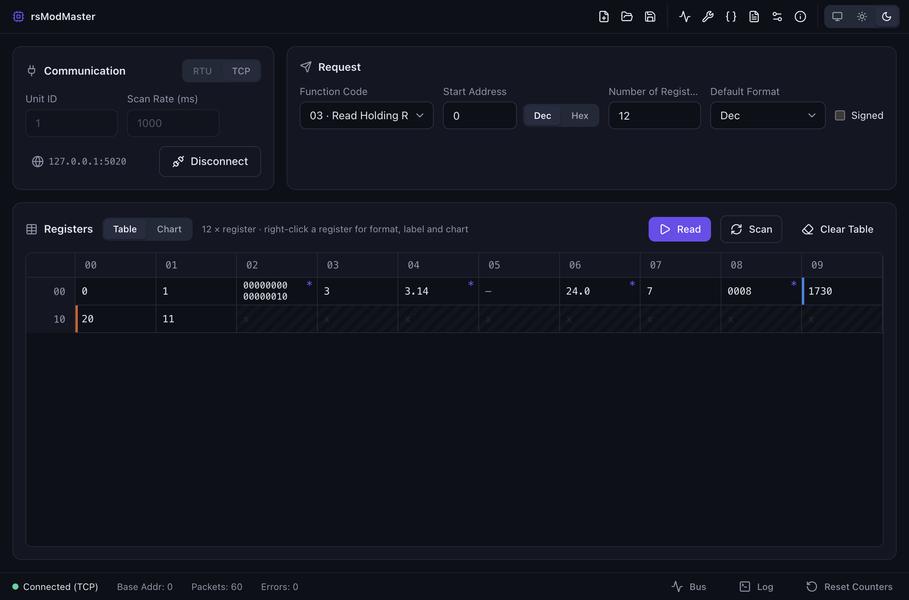
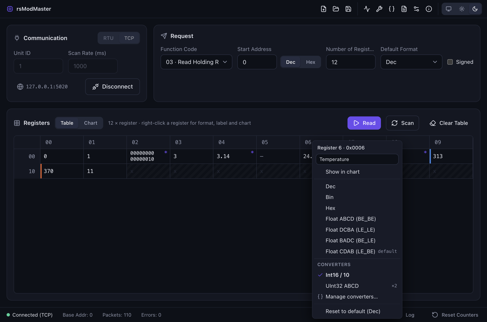
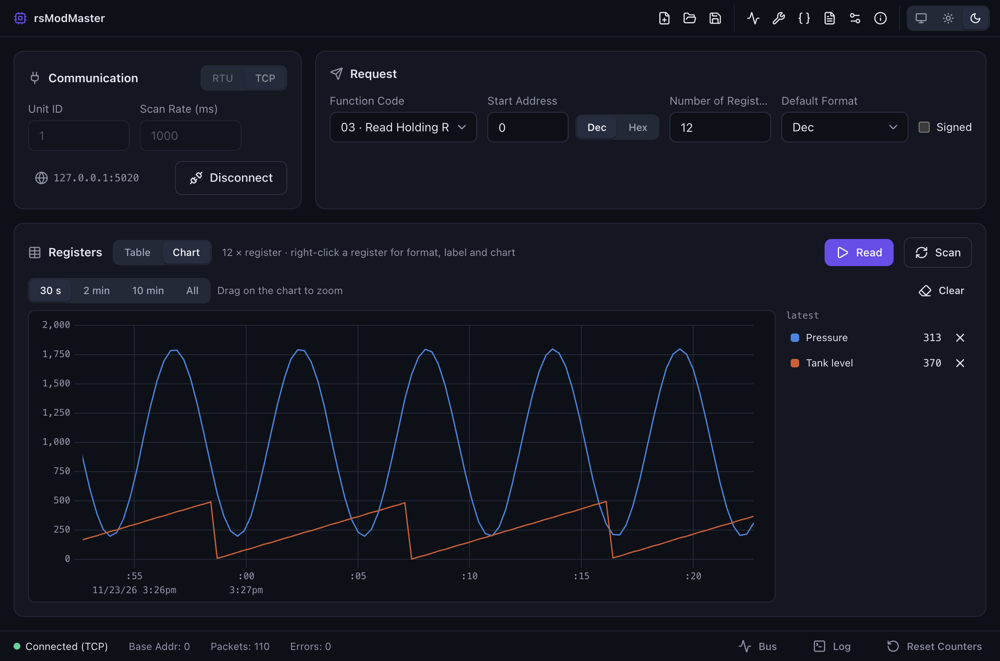
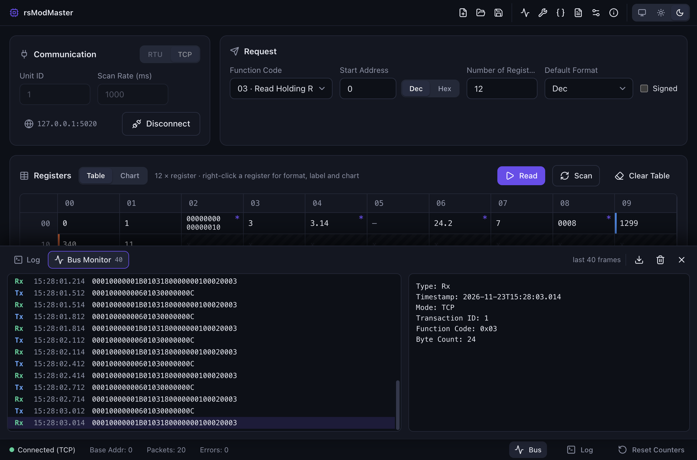
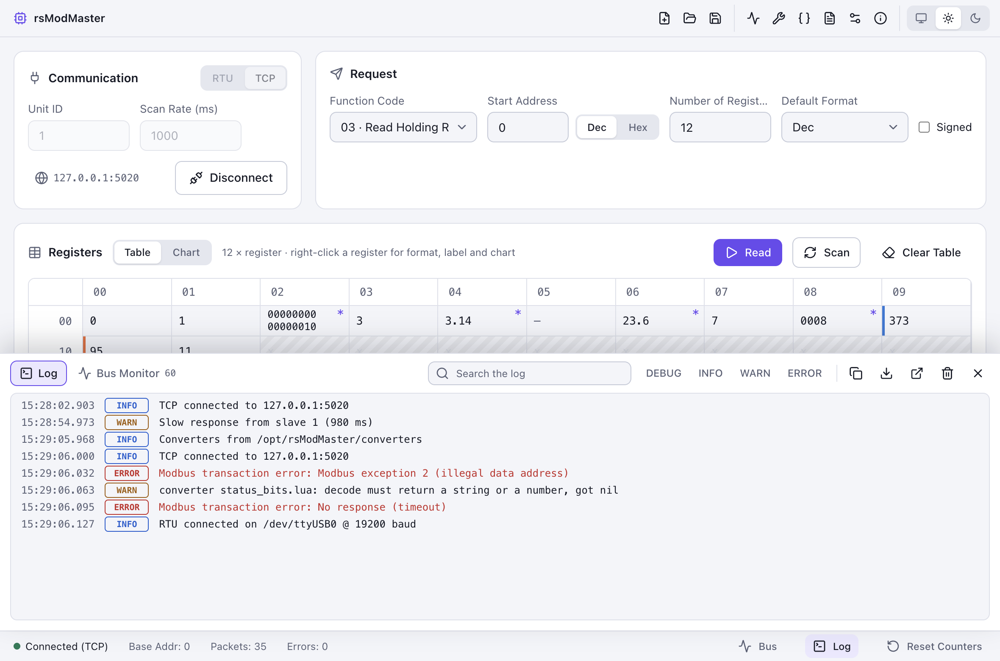
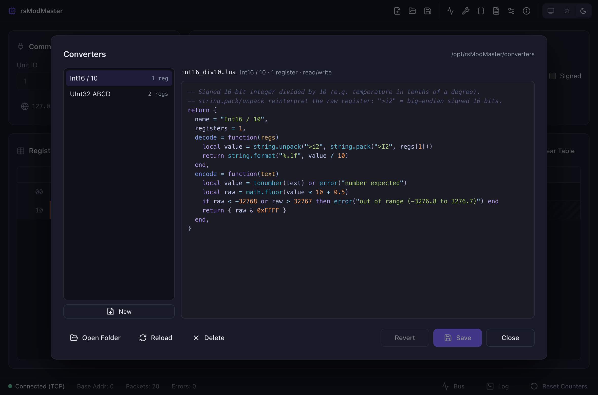

# rsModMaster

Mestre Modbus RTU/TCP para desktop (Windows, Linux e macOS): lê, escreve e escaneia bobinas e
registradores, mostra cada registrador no formato que você escolher, desenha os valores num gráfico
e exibe os quadros brutos do barramento.



É o sucessor do [fModMaster](https://github.com/andersou/fModMaster) (Python/Flet), inspirado no
[qModMaster](https://github.com/epsilonrt/qmodmaster): lê e grava o mesmo `fModMaster.ini` e as
mesmas sessões `.fmmsess`. O núcleo é Rust, a janela é Tauri 2 e a tela é SolidJS.

**Índice:** [Funções](#funções) · [Baixar e instalar](#baixar-e-instalar) · [Como usar](#como-usar) ·
[Custom converters](#custom-converters-lua) · [Arquivos e sessões](#arquivos-e-sessões) ·
[Diferenças do fModMaster](#diferenças-em-relação-ao-fmodmaster) · [Desenvolvimento](#desenvolvimento)

## Funções

| | |
|---|---|
| **Protocolos** | Modbus RTU (serial, CRC) e Modbus TCP (MBAP), implementados à mão no núcleo |
| **Funções Modbus** | FC 01, 02, 03, 04 (leitura), 05, 06, 0F e 10 (escrita); FC 11 (Report Slave ID) no **Tools** |
| **Tabela** | 10 colunas; na escrita, cada célula vira um campo |
| **Formatos** | Bin, Dec (com ou sem sinal), Hex e Float de 32 bits em 4 ordens de byte, por registrador ou para a tabela inteira |
| **Converters** | scripts Lua que transformam registradores em texto (e de volta), editados dentro do app |
| **Scan** | leitura contínua no intervalo do campo **Scan Rate (ms)** (mínimo 50 ms) |
| **Gráfico** | até 8 registradores ao longo do tempo, com zoom e janelas de 30 s a tudo |
| **Bus Monitor** | quadros Tx/Rx brutos e os campos ADU/PDU decodificados |
| **Log** | conexões, erros e mensagens dos converters, com busca e filtro por nível |
| **Tools** | Report Slave ID, ping e teste da porta TCP |
| **Sessões** | `.fmmsess` (e `.ses`/`.ini` do qModMaster), configurações num INI compatível |
| **Tema** | claro, escuro ou o do sistema |
| **Novas versões** | ao iniciar, consulta as releases do GitHub; se houver uma nova, o botão *Download* na barra de título abre a página dela (a atualização é manual). Desliga em *Settings → General*; *About → Check for updates* verifica na hora |
| **Idioma** | inglês, português ou espanhol (bandeira na barra de título; na primeira vez, o do sistema) |

## Baixar e instalar

Baixe o pacote da sua plataforma na [última release](https://github.com/andersou/rsModMaster/releases/latest).
Não há instalador: cada pacote traz o executável e a pasta `converters/` (os exemplos em Lua).

| plataforma | pacote | como abrir | requisito |
|---|---|---|---|
| Windows x64 | `rsModMaster-windows-x64-<versão>.zip` | extraia e abra `rsmodmaster.exe` | WebView2 (já vem no Windows 10/11 atualizado) |
| Linux x64 | `rsModMaster-linux-x64-<versão>.tar.gz` | extraia e rode `./rsmodmaster` | `libwebkit2gtk-4.1` (ex.: `apt install libwebkit2gtk-4.1-0`) |
| macOS arm64 (Apple Silicon) | `rsModMaster-macos-arm64-<versão>.tar.gz` | extraia e rode `./rsmodmaster` | — |

Os `.tar.gz` não têm uma pasta dentro; extraia numa pasta própria e mantenha `converters/` ao lado
do executável:

```sh
mkdir rsModMaster && tar -xzf rsModMaster-linux-x64-<versão>.tar.gz -C rsModMaster
./rsModMaster/rsmodmaster
```

- **Binários sem assinatura:** o SmartScreen (Windows) e o Gatekeeper (macOS) avisam na primeira
  execução. No macOS, se o sistema bloquear, libere em *Ajustes do Sistema → Privacidade e Segurança*
  ou tire a quarentena da pasta extraída: `xattr -dr com.apple.quarantine rsModMaster`.
- **Porta serial no Linux:** costuma exigir o usuário no grupo `dialout`
  (`sudo usermod -aG dialout $USER` e entrar de novo na sessão).
- O pacote de Linux é compilado no Ubuntu 22.04, para rodar também em distribuições mais antigas.

## Como usar

### Conectar

1. No card **Communication**, escolha **RTU** ou **TCP**.
2. Abra **Settings** (ícone na barra de título, ou clique no endereço mostrado no card) e ajuste:

   | aba | campos |
   |---|---|
   | **Modbus RTU** | Serial Port (lista detectada, ou *Other…* para digitar), Baud, Data Bits, Stop Bits, Parity, RTS |
   | **Modbus TCP** | Slave IP, TCP Port |
   | **General** | Response Timeout (ms), Max No Of Bus Monitor Lines, Base Addr, Float Byte Order |

3. Preencha **Slave Addr** (RTU, 0–247) ou **Unit ID** (TCP, 0–255) e clique em **Connect**
   (`⌘K` / `Ctrl+K`). O mesmo botão desconecta.

O timeout de resposta nunca é menor que 1000 ms. No TCP, uma conexão que cai é reaberta na
transação seguinte. O **Base Addr** é descontado do endereço inicial antes de enviar (use 1 para
digitar endereços a partir de 1).

### Ler, escrever e escanear

No card **Request**, escolha a função, o **Start Address** (em **Dec** ou **Hex**; alternar converte
o que foi digitado) e a quantidade.

| ação | como |
|---|---|
| Ler uma vez | **Read** (`⌘↩` / `Ctrl+Enter`) |
| Escrever | escolha uma função de escrita, digite nas células e clique em **Write** (mesmo atalho) |
| Ler continuamente | **Scan**; clique de novo para parar |
| Limpar | **Clear Table** |

| função | quantidade |
|---|---|
| 01 Read Coils, 02 Read Discrete Inputs | 1–2000 |
| 03 Read Holding Registers, 04 Read Input Registers | 1–125 |
| 05 Write Single Coil, 06 Write Single Register | 1 |
| 0F Write Multiple Coils | 2–1968 |
| 10 Write Multiple Registers | 2–123 |

- Um campo inválido (escravo, endereço, quantidade, scan rate) fica marcado e bloqueia a leitura, a
  escrita e o scan; nada é ajustado em silêncio.
- Uma escrita que falha mantém o que foi digitado; uma que dá certo confirma com um aviso.
- No scan, o mesmo erro repetido vira um aviso só, até mudar.
- A barra de status mostra a conexão, o Base Addr e os contadores **Packets** e **Errors**
  (**Reset Counters** zera).

### Formatos, labels e floats

O **Default Format** vale para a tabela inteira. Para um registrador só, clique com o botão direito
nele:



- **Dec**, **Bin**, **Hex** ou **Float** de 32 bits nas 4 ordens de byte do libmodbus: ABCD (BE_BE),
  DCBA (LE_LE), BADC (BE_LE) e CDAB (LE_BE). A ordem marcada como `default` é a **Float Byte Order**
  das configurações.
- O float ocupa dois registradores: o primeiro mostra o valor e o segundo mostra `—`. Escrever um
  float exige FC 10, e uma escrita que começaria na 2ª metade de um float é recusada.
- **Signed** (ao lado do Default Format, só em Dec) mostra e aceita valores com sinal.
- Registradores com formato próprio ganham um `*` no canto; **Reset to default** volta ao formato da
  tabela.
- O campo no topo do menu é o **label** do registrador (até 32 caracteres): aparece no tooltip da
  célula e na legenda do gráfico.
- Bobinas e entradas discretas não têm formato: são sempre 0/1.

### Gráfico

Botão direito num registrador → **Show in chart** (até 8, cada um na sua cor; a célula ganha uma
faixa dessa cor). Depois troque a visão em **Table | Chart**, ou `⌘G` / `Ctrl+G`, e use **Read** ou
**Scan** para gerar as amostras.



- O gráfico mostra o valor que a tabela mostra (float, converter numérico, com sinal). Texto, `ERR`
  e erro de comunicação viram lacuna. Bobinas aparecem em degraus, uma faixa por bobina.
- Janela de **30 s**, **2 min**, **10 min** ou **All**. Arrastar no gráfico dá zoom e pausa o
  acompanhamento; **Live** volta a seguir as amostras novas.
- Na legenda, clicar numa série a esconde ou mostra, e o `×` a tira do gráfico.
- O histórico fica só em memória (20 mil amostras) e zera ao trocar de função ou de sessão. O
  gráfico é das leituras: numa função de escrita, a tabela volta.

### Bus Monitor

O botão **Bus** na barra de status (ou o ícone da barra de título) abre a aba **Bus Monitor** do
painel de baixo: os quadros Tx/Rx brutos com a hora e, à direita, os campos ADU/PDU do quadro
selecionado. Por ser um painel e não um diálogo, dá para ler, escrever e escanear olhando os quadros.



Ficam os últimos N quadros (**Max No Of Bus Monitor Lines**, 60 por padrão). Os ícones do painel
salvam os quadros num `.txt` e limpam a lista; `Esc` fecha o painel.

### Log

O botão **Log** abre a outra aba do painel: conexões, erros de transação e mensagens dos converters
desde que o app abriu.



- Busca por texto e filtro por nível (escolher vários níveis mostra qualquer um deles).
- Copiar ou exportar as linhas visíveis, abrir o arquivo de log e limpar o painel.
- Com o painel fechado, o botão **Log** mostra um selo com os erros que chegaram.
- O painel guarda as últimas 5000 linhas; o histórico completo fica no arquivo `rsModMaster.log`
  (até 2 MB por arquivo, com os 3 últimos mantidos).

### Tools

O ícone de chave na barra de título abre o **Tools**: **Report Slave ID** (FC 11, na conexão aberta)
e, no modo TCP, **Ping** e **Port Status** no IP e na porta configurados (espera de até 5 s).

### Atalhos

| atalho | ação |
|---|---|
| `⌘K` / `Ctrl+K` | conecta ou desconecta |
| `⌘↩` / `Ctrl+Enter` | lê ou escreve |
| `⌘G` / `Ctrl+G` | alterna tabela e gráfico |
| `⌘S` / `Ctrl+S` | salva o converter (no diálogo Converters) |
| `Esc` | fecha o painel de baixo |

Os três primeiros não agem com um diálogo aberto.

## Custom converters (Lua)

Um converter transforma um ou mais registradores num texto e, se quiser, o texto digitado de volta
em registradores. O botão `{ }` da barra de título abre o diálogo **Converters**, com a lista e um
editor com destaque de sintaxe:



Cada converter é um arquivo `<id>.lua` (letras, dígitos, `_` e `-`) que retorna uma tabela:

```lua
return {
  name = "UInt32 ABCD",          -- opcional (padrão: o nome do arquivo)
  registers = 2,                 -- opcional (padrão 1, máximo 125)
  decode = function(regs)        -- regs = { u16, ... } com exatamente `registers` itens
    return (regs[1] << 16) | regs[2]           -- texto ou número mostrado na célula
  end,
  encode = function(text)        -- opcional; sem ele o converter é só leitura
    local n = math.tointeger(tonumber(text)) or error("integer expected")
    return { (n >> 16) & 0xFFFF, n & 0xFFFF }  -- exatamente `registers` valores 0..65535
  end,
}
```

O pacote traz três exemplos: `int16_div10` (inteiro com sinal ÷ 10), `uint32_abcd` (32 bits em 2
registradores) e `status_bits` (bits viram nomes, só leitura).

- **Usar:** botão direito num registrador → seção *Converters*, ou como **Default Format** da tabela
  inteira (em blocos a partir do endereço inicial, sem passar por cima de registrador com formato
  próprio). A célula inicial mostra o valor e as seguintes mostram `—`, como num float.
- **Erros:** um erro do script aparece como `ERR` na célula (mensagem no tooltip e num aviso) e o
  scan continua.
- **Editar:** **Save** (`⌘S` / `Ctrl+S`) grava e recarrega na hora, mostrando o erro com a linha;
  **Revert** desfaz a edição; **New** parte de um modelo; **Delete** apaga o arquivo. Quem preferir
  outro editor usa **Open Folder** e depois **Reload**.
- **Escrever:** com `encode`, a célula vira campo. Um converter só leitura bloqueia a escrita, e um
  de mais de um registrador exige FC 10.

**Onde ficam:** na pasta `converters/` ao lado do executável (o diálogo mostra o caminho em uso).
Ordem de busca: a variável `RSMODMASTER_CONVERTERS_DIR`, `converters/` ao lado do executável,
`Resources/converters` num bundle do macOS e, em desenvolvimento (`cargo run`), `core/converters`.

**Sandbox e limites:**

| | |
|---|---|
| Linguagem | Lua 5.4 (mlua), só com `math`, `string` e `table` |
| Fora do sandbox | `io`, `os`, `require`, `load`, `loadfile`, `dofile`, `pcall`, `xpcall`, `print`, `collectgarbage`, `string.dump`, corrotinas e `debug` |
| Instruções | 100 mil por chamada (um loop infinito vira erro, não trava o app) |
| Memória | 16 MB |
| Texto | até 64 caracteres (mostrado ou digitado) |
| Arquivos | até 200, de até 64 KB cada |

Operadores de bit e `string.pack`/`string.unpack` (`">i2"`, `">f"`, `"<I4"`...) cobrem inteiros com
sinal, floats e ordem de bytes. Cada arquivo tem seu próprio ambiente: um global definido num
converter não aparece nos outros.

## Arquivos e sessões

As configurações e a sessão atual ficam no `fModMaster.ini`, gravado ao conectar, a cada
leitura/escrita e ao mudar formatos ou configurações. Na primeira execução, um `fModMaster.ini` na
pasta atual ou ao lado do executável é copiado para a pasta do app.

| sistema | INI | log (`rsModMaster.log`) |
|---|---|---|
| Windows | `%APPDATA%\io.github.andersou.rsmodmaster` | `%LOCALAPPDATA%\io.github.andersou.rsmodmaster\logs` |
| Linux | `~/.config/io.github.andersou.rsmodmaster` | `~/.local/share/io.github.andersou.rsmodmaster/logs` |
| macOS | `~/Library/Application Support/io.github.andersou.rsmodmaster` | `~/Library/Logs/io.github.andersou.rsmodmaster` |

**Sessões:** os três primeiros ícones da barra de título são **New Session**, **Load Session**
(`.fmmsess`, `.ses` ou `.ini`) e **Save Session** (`.fmmsess`). A sessão tem o mesmo formato do INI.

**O que vai além do qModMaster** fica em seções próprias, que o qModMaster ignora e o fModMaster
apaga se salvar o arquivo:

| seção | conteúdo |
|---|---|
| `[RegisterFormats]`, `[RegisterFloatEndians]` | formato e ordem de bytes por endereço |
| `[RegisterConverters]` | `endereço = id` do converter; `[Session] DefaultConverter` guarda o do formato padrão |
| `[RegisterLabels]` | label por endereço |
| `[RegisterCharts]` | registradores no gráfico e a cor de cada um |

A sessão guarda só o id do converter: em outra máquina sem o arquivo `.lua`, a célula mostra `ERR`.
O tema, o idioma, a verificação de versões e a janela de tempo do gráfico ficam gravados no app, não na sessão.

## Diferenças em relação ao fModMaster

- As chaves do INI são gravadas como o qModMaster grava (`TCPPort`, `SlaveIP`...); o fModMaster
  gravava tudo em minúsculas. Os dois formatos são lidos.
- `Base = 0` (Hex) volta como Hex; o fModMaster lia como Dec.
- Timeout menor que 1000 ms (inclusive o `TimeOut = 0` padrão) vira 1000 ms, como antes.
- O ping espera até 5 s também no Windows e no macOS (lá o `-w`/`-W` é em ms, e o fModMaster
  passava `5`).
- Bobinas e entradas discretas ignoram formato: são sempre 0/1.
- O cabeçalho das linhas da tabela segue o Dec/Hex do endereço inicial, não o formato dos valores.
- Erro repetido no scan vira um aviso só, até mudar.
- Campos inválidos ficam marcados e bloqueiam a leitura, a escrita e o scan, em vez de serem
  ajustados em silêncio. O scan tem mínimo de 50 ms, e alternar Dec/Hex converte o endereço digitado.
- Uma escrita que começaria na 2ª metade de um float é recusada (o fModMaster deslocava os valores),
  e o núcleo recusa qualquer escrita sem exatamente um valor por item.
- Uma escrita que falha mantém o que foi digitado; uma que dá certo confirma com um aviso.
- Sem menu nativo: as ações de File, View e Help ficam na barra de título. Não há o "Modbus Manual"
  (o fModMaster só o abria se a documentação do qModMaster estivesse no checkout).
- Novos: converters em Lua, gráfico, labels, painel de log e temas.

## Desenvolvimento

Orientações para agentes de código (convenções, invariantes e armadilhas) estão em
[`AGENTS.md`](AGENTS.md).

### Estrutura

| pasta | pacote Cargo | o que é |
|---|---|---|
| `core/` | `modmaster-core` (biblioteca, sem UI) | Modbus RTU e TCP, scan numa thread, decodificação dos quadros para o bus monitor, INI do qModMaster, converters Lua, ping e porta TCP |
| `core/converters/` | — | os converters de exemplo que vão nos pacotes |
| `.` (`src/`, `tauri.conf.json`, `capabilities/`) | `rsmodmaster` | app desktop (Tauri 2): janela, diálogos de arquivo, onde fica o INI, log e ponte dos eventos |
| `ui/` | — | a tela em SolidJS + Vite, com o design system do garten-updater (ícones Lucide, uPlot no gráfico, Shiki no editor) |
| `ui/src/lib/` | — | regras da tela sem DOM (formatos, grade, gráfico, validação, log), testadas com Vitest |
| `tools/modbus_sim.py` | — | escravo Modbus TCP de teste (pymodbus) |
| `docs/images/` | — | as capturas deste README |

### Requisitos

- Rust >= 1.95 e Node 24 + npm. O Tauri CLI não é usado.
- No Linux, as bibliotecas do Tauri:
  `libwebkit2gtk-4.1-dev libxdo-dev libayatana-appindicator3-dev librsvg2-dev`.

### Rodar e compilar

```sh
(cd ui && npm ci && npm run build)   # tsc + vite build -> ui/dist, que o binário embute
cargo run -p rsmodmaster
```

UI com recarga instantânea (HMR), em dois terminais:

```sh
cd ui && npm run dev
TAURI_CONFIG='{"build":{"devUrl":"http://localhost:5173"}}' cargo run -p rsmodmaster
```

Release, como o `tauri build` faria (sem gerar instalador):

```sh
cargo build --release -p rsmodmaster --features tauri/custom-protocol
```

### Testes

```sh
cargo fmt --all --check
cargo clippy --workspace --all-targets -- -D warnings
cargo test --workspace     # protocolo, INI, converters, escravo TCP falso e RTU num pseudo-terminal (Unix)
(cd ui && npm test)        # Vitest: formatos, floats, grade, escrita, gráfico, log, tema
(cd ui && npm run check)   # tipos (tsc)
```

**Conformidade com um escravo de verdade** (todas as funções e uma exceção), contra uma
implementação independente como o pymodbus. Não roda no `cargo test` comum:

```sh
MODBUS_SIM=127.0.0.1:5020 cargo test -p modmaster-core --test simulator -- --ignored
```

O escravo precisa servir, a partir do endereço 0, 100 bobinas `1,0,1,0...`, 100 entradas
`0,1,0,1...`, holding registers `0..99` e input registers `1000..1099`, com os valores parados (o
teste escreve em alguns; reinicie o escravo antes de rodar de novo). O `tools/modbus_sim.py` é esse
escravo:

```sh
uv run --with 'pymodbus==3.13.*' python tools/modbus_sim.py 5020          # para o teste
uv run --with 'pymodbus==3.13.*' python tools/modbus_sim.py 5020 --vary   # para testar o app à mão
```

Com `--vary`, o registrador 9 varia como senoide e o 10 como rampa, para o gráfico ter movimento
(o teste de conformidade, que espera valores parados, não passa nesse modo). A versão do pymodbus
fica fixa porque ele serve os blocos de holding e input de jeitos diferentes entre versões.

**A tela no navegador, sem o app nem um escravo:** `ui/mock.html` carrega a UI com o IPC do Tauri
simulado (`ui/mock.ts`). Não entra no build.

```sh
cd ui && npm run dev      # abra http://localhost:5173/mock.html
```

### CI e versões

O semantic-release gera as versões a partir dos commits
([Conventional Commits](https://www.conventionalcommits.org/)): `fix:` e `perf:` sobem o patch, `feat:` sobe o
minor e uma breaking change (`feat!:` ou `BREAKING CHANGE:`) sobe o major. Outros tipos (`chore:`,
`docs:`, `ci:`...) não geram versão.

| branch | versões |
|---|---|
| `main` | `X.Y.Z` |
| `next` | `X.Y.Z-preview.N` |

Jobs de `.github/workflows/ci.yml`:

| job | quando | o que faz |
|---|---|---|
| `check` | todo push e PR | Vitest, tipos, `ui/dist`, fmt, clippy (`-D warnings`) e testes do workspace, no Rust estável mais recente |
| `version` | push em `main`/`next` | calcula a próxima versão (semantic-release em dry-run) e a grava no `Cargo.toml`/`Cargo.lock` dos builds |
| `build` | depois de `check` | executável + pasta `converters/` de Linux x64, macOS arm64 e Windows x64 (artefatos do workflow) |
| `release` | quando há versão nova | tag `vX.Y.Z`, release no GitHub com os três pacotes e o commit da versão (`[skip ci]`) |

No repositório, a versão do `Cargo.toml` é a da última tag (o commit de release a atualiza). A
configuração está em `release.config.cjs` e usa só o `GITHUB_TOKEN` do workflow.

### Segurança

- **CSP estrita** (`tauri.conf.json`): `default-src 'self'`, conexão só com o IPC, sem `object`,
  `base` nem `form-action`. Não há script nem estilo inline, nem WASM (o Shiki usa o motor de regex
  em JavaScript).
- **Capabilities mínimas** (`capabilities/default.json`): ouvir eventos, arrastar e maximizar a
  janela, tema e cor de fundo, e abrir URLs só de `https://github.com/*`. Sem acesso a arquivos ou
  ao shell pela webview.
- **Caminhos de arquivo só por diálogo nativo:** sessão, exportação do log e do bus monitor passam
  pelo diálogo do sistema, aberto pelo Rust. A webview nunca envia um caminho; dos converters ela
  envia só o id, validado (`[A-Za-z0-9_-]`, até 64 caracteres) antes de virar nome de arquivo.
- **Sandbox do Lua:** sem disco, rede ou carga de código, com limite de instruções e de memória
  (veja [Custom converters](#custom-converters-lua)).
- **Ping:** o IP é validado como IPv4 antes de ir para o `ping` do sistema.

## Licença

MIT. Veja [LICENSE](LICENSE).
